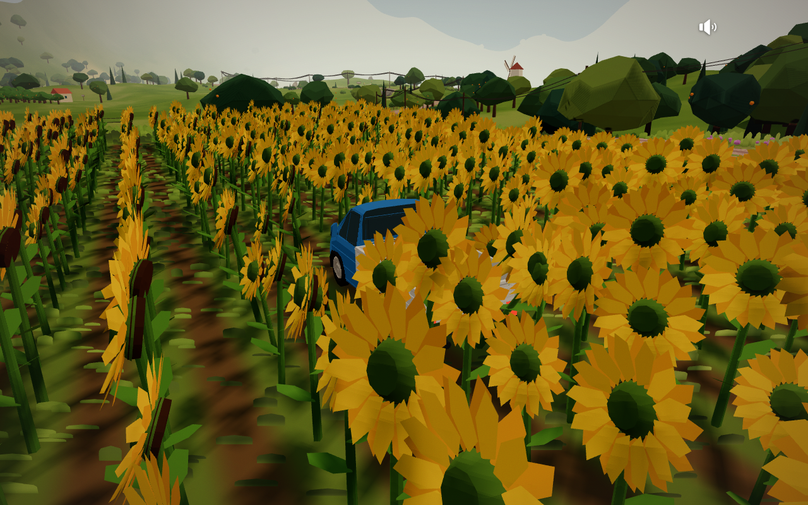
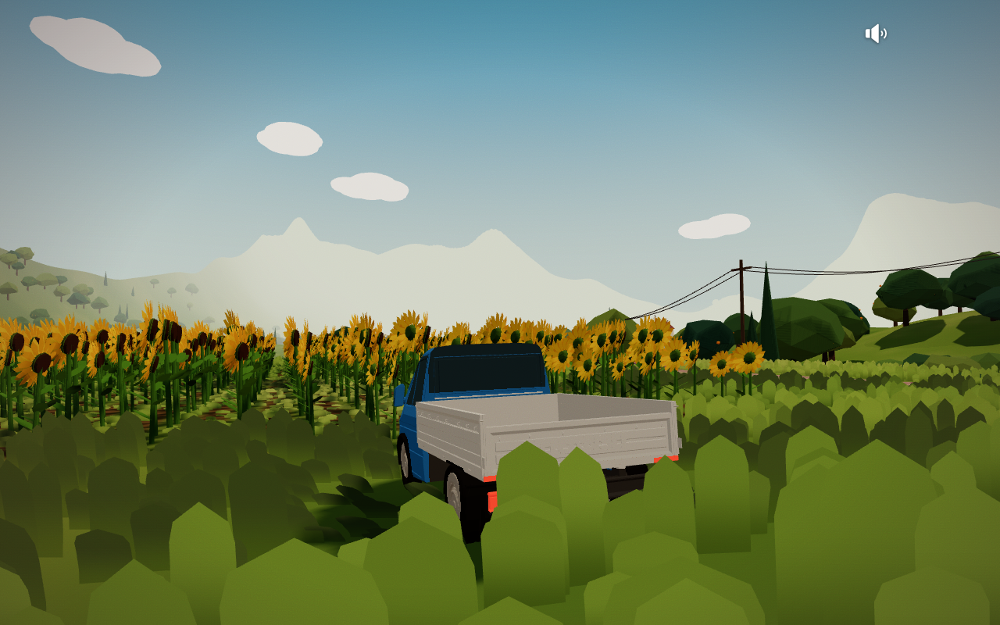

# Sunfield

A cosy Three.js driving game: pick a vehicle, run errands around a painterly valley, and try not to bounce your cargo out of the bed. Finish 5 errands to open the Town, a second level with traffic, police and weather.

Play it at [sun.ajerbi.com](https://sun.ajerbi.com).

Inspired by the work of [iorama.studio](https://www.instagram.com/iorama.studio/).

## Play

Open `index.html` in a browser (a recent Chrome, Safari, Firefox or Edge with WebGL2). Three.js, the fonts and the icons load from CDNs, so you need an internet connection.

## Controls

| Key | Action |
|---|---|
| W A S D / arrows | Drive |
| Shift | Fire boost |
| Space | Handbrake |
| H | Horn |
| C | Camera |
| T | Skip to the next time of day |
| Y | Cycle the weather: Auto, Clear, Fog, Rain (Town) |
| R | Back to the road |
| M | Mute |
| Esc | Pause |

On the start screen, use ‹ › to pick a vehicle, ↑ ↓ to switch between the Valley and the Town, and drag to spin it. On phones, touch and drag anywhere to steer, and hold the fire button to boost.

### Game controller

| Button (Xbox names) | Action |
|---|---|
| Left stick / D-pad ← → | Steer |
| RT or A | Gas (the trigger gives partial throttle) |
| LT or B | Brake and reverse |
| X | Handbrake |
| RB, LB or L3 | Fire boost |
| Y | Horn |
| D-pad ↑ / ↓ | Camera / back to the road |
| Select (View) | Next time of day |
| Start (Menu) | Pause |

Menus work with the controller too: pick a vehicle with ← →, switch level with ↑ ↓, start with A, and move through the pause menu with ↑ ↓. A 🎮 badge on the start screen shows when a controller is detected, and it rumbles on hard hits.

Browsers only see a controller after you press one of its buttons with the page open. On macOS, an 8BitDo in Switch mode works in Safari but not in Chrome or Brave, whose own Nintendo driver doesn't accept it.

## Levels

- **The Valley** (`index.html`): where you start.
- **The Town** (`level-02.html`): opens once you've finished 5 errands in the Valley. Pick it on the start screen, or use Pause → Go to the Town. Your progress is saved in the browser, so it stays unlocked.

## Features

- Three vehicles: Bruno (blue dropside truck, the default), Bianca (camper pickup) and Pippo (cream 504-style pickup)
- On-road, off-road and beach errands with loose cargo physics
- A sunflower field beside the road: rows of sunflowers that sway in the wind and bend aside as you drive through
- Fire boost: fill it with oranges knocked from trees, completed errands, or a full flock of 3 sheep
- A secret bunker with an engine that adds 3 boost tanks
- A lighthouse to climb, off-road ramps, and a lake with fish
- Day, evening and night cycle with headlights
- Sandy beach with tyre tracks, beach balls and a lifeguard tower

### In the Town

- A grid of streets with traffic lights, cars that stop at red lights and give way at crossings, and people walking the pavements
- Traffic you can shove: hit a car and it slides and spins away, then pulls back into its lane
- Police in 80s black-and-white cruisers: knock over a pedestrian or rear-end a cop car to earn a wanted star (shown beside the sheep count), and dive under the lake to lose them. Their flashing lights wash the road red and blue
- Town runs: errands between nine stops downtown (City Hall, Corner Café, Post Office, Flower Shop, Bakery, Grocer, Fire Station, Bookshop and Town Library), each marked by a shop sign, carrying mail sacks, flower pots, birthday cakes and more
- Orange trees along the streets: bump them to knock oranges down
- Fire hydrants on the pavements: knock one over and it gushes water into the air and soaks the road around it
- Wooden piers out over the lake that you can drive along, and off
- Weather: heavy fog, or rain with wet dark roads that reflect street lamps, traffic lights and headlights at night, and the lights coming on. It changes by itself every minute or two, or set it from the pause menu

## Files

- `index.html`: the Valley (level 1)
- `level-02.html`: the Town (level 2)
- `ford-model.js`: Bruno's mesh (the truck model, packed so the game loads it as a script)
- `music/`: background music and the grass driving sound
- `screenshots/`: images used in this README
