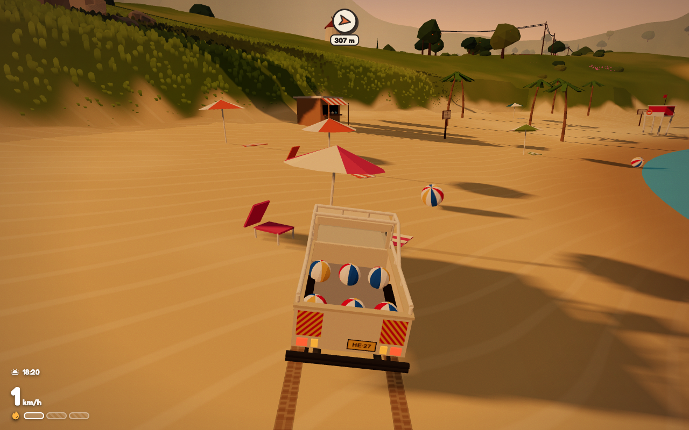

# Errand Hill

A cosy Three.js driving game: pick a vehicle, run errands around a painterly valley, and try not to bounce your cargo out of the bed.

## Play

Open `index.html` in a browser (a recent Chrome, Safari, Firefox or Edge with WebGL2). Three.js, the fonts and the icons load from CDNs, so you need an internet connection.

## Controls

| Key | Action |
|---|---|
| W A S D / arrows | Drive |
| Shift | Fire boost |
| Space | Handbrake |
| H | Horn |
| C | Camera |
| T | Skip to the next time of day |
| R | Back to the road |
| M | Mute |
| Esc | Show or hide the current errand |

On the start screen, use ‹ › to pick a vehicle and drag to spin it.

## Features

- Three vehicles: Bianca (camper pickup), Pippo (cream 504-style pickup) and Bruno (blue dropside truck, built from `ford.stl`)
- On-road, off-road and beach errands with loose cargo physics
- Fire boost: fill it with oranges knocked from trees, completed errands, or a full flock of 3 sheep
- Day, evening and night cycle with headlights
- Sandy beach with tyre tracks, beach balls and a lifeguard tower

## Files

- `index.html`: the whole game
- `ford-model.js`: Bruno's mesh, packed from `ford.stl`
- `music/`: background music and the grass driving sound
