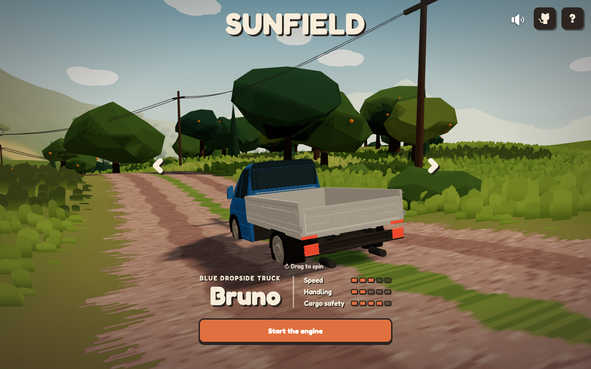

# Sunfield

A cosy Three.js driving game: pick a vehicle, run errands around a painterly valley, and try not to bounce your cargo out of the bed.

Play it at [sun.ajerbi.com](https://sun.ajerbi.com).

## Play

Open `index.html` in a browser (a recent Chrome, Safari, Firefox or Edge with WebGL2). Three.js, the fonts and the icons load from CDNs, so you need an internet connection.

## Controls

| Key | Action |
|---|---|
| W A S D / arrows | Drive |
| Shift | Fire boost |
| Space | Handbrake |
| H | Horn |
| C | Camera |
| T | Skip to the next time of day |
| R | Back to the road |
| M | Mute |
| Esc | Pause |

On the start screen, use ‹ › to pick a vehicle and drag to spin it. On phones, touch and drag anywhere to steer, and hold the fire button to boost.

### Game controller

| Button (Xbox names) | Action |
|---|---|
| Left stick / D-pad ← → | Steer |
| RT or A | Gas (the trigger gives partial throttle) |
| LT or B | Brake and reverse |
| X | Handbrake |
| RB, LB or L3 | Fire boost |
| Y | Horn |
| D-pad ↑ / ↓ | Camera / back to the road |
| Select (View) | Next time of day |
| Start (Menu) | Pause |

Menus work with the controller too: pick a vehicle with ← →, start with A, and move through the pause menu with ↑ ↓. A 🎮 badge on the start screen shows when a controller is detected, and it rumbles on hard hits.

Browsers only see a controller after you press one of its buttons with the page open. On macOS, an 8BitDo in Switch mode works in Safari but not in Chrome or Brave, whose own Nintendo driver doesn't accept it.

## Features

- Three vehicles: Bruno (blue dropside truck, built from `ford.stl`, the default), Bianca (camper pickup) and Pippo (cream 504-style pickup)
- On-road, off-road and beach errands with loose cargo physics
- A sunflower field beside the road: rows of sunflowers that sway in the wind and bend aside as you drive through
- Fire boost: fill it with oranges knocked from trees, completed errands, or a full flock of 3 sheep
- A secret bunker with an engine that adds 3 boost tanks
- A lighthouse to climb, off-road ramps, and a lake with fish
- Day, evening and night cycle with headlights
- Sandy beach with tyre tracks, beach balls and a lifeguard tower

## Files

- `index.html`: the whole game
- `ford-model.js`: Bruno's mesh, packed from `ford.stl`
- `music/`: background music and the grass driving sound
- `screenshots/`: images used in this README
